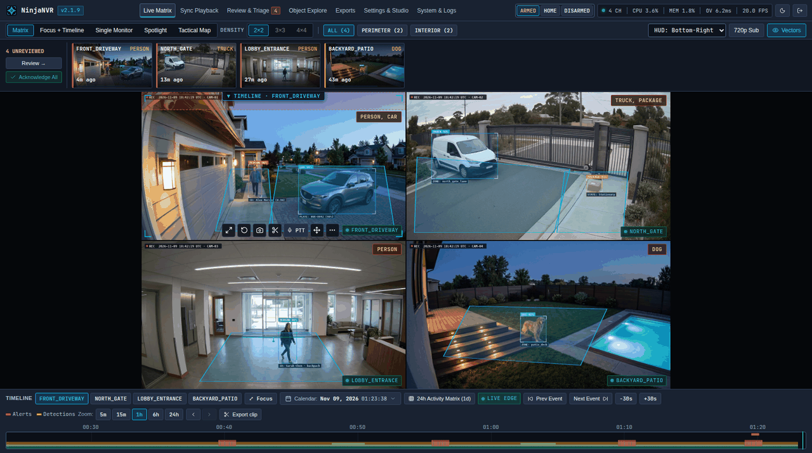
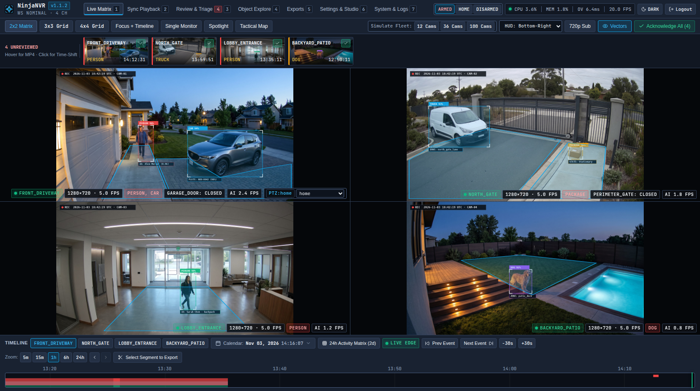
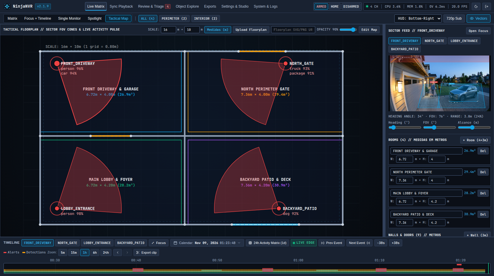
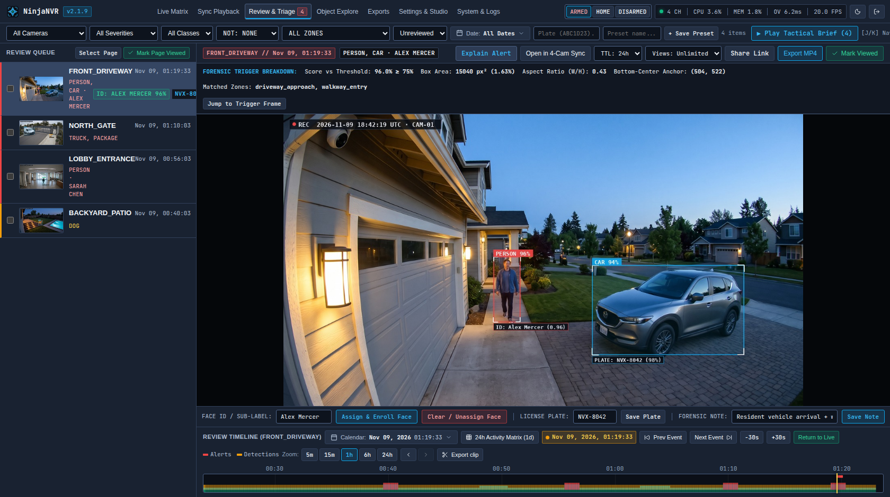
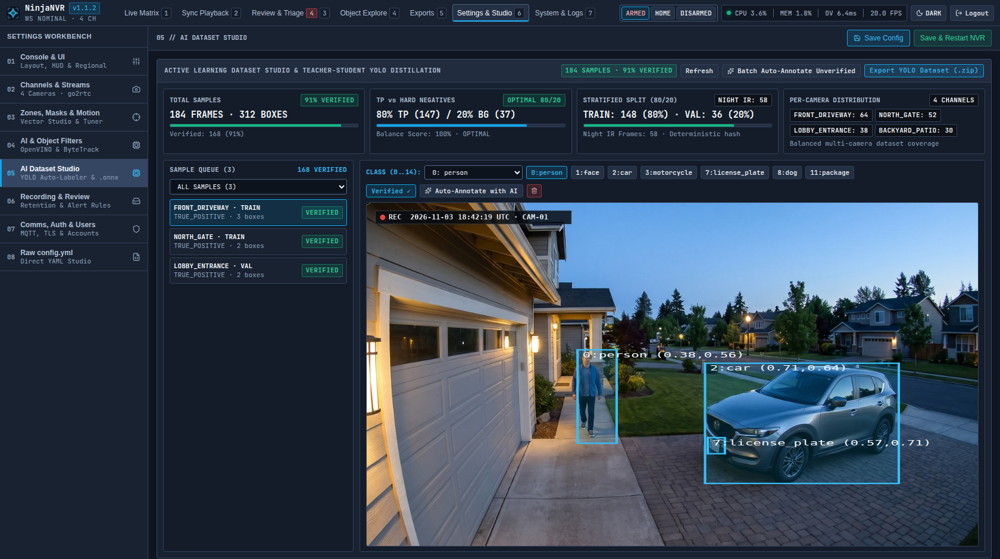

#  NinjaNVR

NinjaNVR is a self-hosted network video recorder with a Rust backend and a React console. It records camera streams, detects and tracks objects locally, and brings live video, recordings, alerts, and camera controls into one interface.

[](https://github.com/JustShinobi/NinjaNVR/actions/workflows/ci.yml)
[](https://github.com/JustShinobi/NinjaNVR/releases)
[](https://github.com/JustShinobi/NinjaNVR/pkgs/container/ninjanvr)
[](LICENSE)

[Quickstart](#quickstart) · [Features](#features) · [Recent additions](#recent-additions) · [Hardware](#hardware) · [Build from source](#build-from-source)

<p align="center">
  
</p>

The NVR runs on your own hardware. Object detection uses OpenVINO or ONNX Runtime; recordings and event data stay on local storage unless you configure backups or external integrations. Optional image verification and dataset annotation can use Ollama, OpenAI, or Gemini.

## Quickstart

From a checkout of this repository, copy the [example configuration](config/config.example.yml) and replace the camera addresses and credentials:

```bash
mkdir -p config-local storage
cp config/config.example.yml config-local/config.yml
```

The example uses separate streams for detection and recording. Update both `go2rtc.streams` entries for your camera; the `127.0.0.1:8554` addresses under `cameras` refer to the restreamer inside the container.

```bash
docker run -d \
  --name ninjanvr \
  --restart unless-stopped \
  -p 8971:8971 \
  -p 8554:8554 \
  -p 8555:8555/tcp \
  -p 8555:8555/udp \
  -v "$PWD/config-local:/config" \
  -v "$PWD/storage:/media/ninjanvr" \
  ghcr.io/justshinobi/ninjanvr:latest
```

Open `https://localhost:8971`. The server generates a TLS certificate when none is configured. The `latest` image follows stable releases; `dev` follows pre-releases from the development branch.

| Port | Purpose |
| :--- | :--- |
| `8971/tcp` | HTTPS console and authenticated API |
| `5000/tcp` | Internal HTTP API and container health checks; not published above |
| `8554/tcp` | go2rtc RTSP restreaming |
| `8555/tcp+udp` | WebRTC media |

Configuration and the SQLite database persist in `/config`; recordings persist in `/media/ninjanvr`. See [authentication](docs/operations/security-and-auth.md) for local accounts, OIDC, proxy authentication, and API tokens.

## Features

### Live view and playback

- Camera groups and a paginated matrix, Spotlight for active cameras, and a floorplan view with camera positions and fields of view.
- WebRTC and MSE live video, digital zoom and pan, camera rotation, PTZ presets, and two-way audio on compatible cameras.
- A recording timeline with event markers, audio levels, offline gaps, frame stepping, and synchronized playback of up to four cameras.
- Review and Explore filters, saved searches, operator notes, daily alert playback, and MP4 exports with optional audio removal.
- Dark, light, and high-contrast display settings, plus layouts for desktop and phone screens.

### Detection and alert rules

- Motion-gated object detection with ByteTrack tracking, stationary-object handling, polygon zones, loitering rules, and directional line crossings.
- Local face gallery and license plate recognition, including face assignment across selected events and registration of detected plates.
- State regions for open/closed monitoring, day/night detection profiles, camera tamper detection, and motion and privacy masks.
- An alert inspector showing the triggering frame, detection score, object geometry, and zone rule. False-positive signatures can suppress recurring matches; an optional Vision AI Judge can check detections with a vision model.
- Runtime camera, detection, recording, and alert switches, with Armed, Home, and Disarmed profiles available through the console, API, and MQTT.

### Datasets and models

- Send events to Dataset Studio, edit bounding boxes, and curate positive and negative samples.
- Annotate samples with a configured vision model, run batches with progress and cancellation, and distinguish AI verification from manual review.
- Upload and deploy detector models without restarting the server. The console reports the model actually loaded, deployment outcome, and measured inference latency.
- Prepare datasets and train or fine-tune the 15-class security model with the [training scripts](scripts/ai). Training requires a separate Python environment and its model-training dependencies.

### Storage and access

- Record streams into 10-second MP4 segments without video transcoding. Hybrid recording keeps a substream continuously and switches to the main stream for events.
- Retention by age and disk quota, hot-to-cold storage migration, optional cold compaction, and alert clip backups.
- Continue live view and detection when a recording mount becomes unavailable, then recover recording when storage returns.
- Local authentication, OIDC, trusted-proxy authentication, roles with per-camera access, scoped API tokens, and expiring clip links with revocation controls.
- Home Assistant MQTT discovery, MQTT over TLS, Prometheus metrics, multi-instance federation, and AI context/MCP query endpoints.

## Recent additions

Recent development has focused on camera operation, configuration, and the review workflow:

- **Camera hardware controls:** protocol-specific discovery and controls for supported Tapo, Dahua/Intelbras, Hikvision, Reolink, Axis, and generic ONVIF devices. Available controls depend on the camera's reported capabilities and firmware: PTZ, presets, day/night mode, lighting, image adjustments, speaker volume, and reboot.
- **Camera alarms:** manual speaker siren playback on supported Tapo and Dahua/Intelbras cameras, plus automatic triggers from selected zones and directional lines. Tapo speaker access requires the TP-Link account password in addition to the local camera credentials. See [camera configuration](docs/configuration/cameras.md) and [alarm rules](docs/configuration/detection.md).
- **Diagnostics and recovery:** camera diagnostic logs, ONVIF PullPoint events, syslog and scheduled-maintenance controls where supported, and a reboot watchdog for repeated RTSP stalls.
- **Areas, lines, and masks:** the editor groups tools by purpose, preserves coordinates across viewport sizes, and applies saved zones, masks, and motion settings without a server restart.
- **Live and mobile layouts:** compact camera tiles with a details sheet, a collapsible desktop header, and phone layouts across live view, playback, Review, and Explore.
- **Snapshots and review:** full-resolution snapshot downloads with privacy masks applied, event-strip frame previews, batch face assignment, and automatic annotation when adding events to a dataset.

See the [commit history](https://github.com/JustShinobi/NinjaNVR/commits/dev/) for development changes and [releases](https://github.com/JustShinobi/NinjaNVR/releases) for published versions.

## Screenshots

| Live view | Floorplan editor |
| :---: | :---: |
| [](docs/public/assets/live-matrix.png) | [](docs/public/assets/floorplan-cad.png) |
| Event review | Dataset Studio |
| [](docs/public/assets/review-forensic.png) | [](docs/public/assets/ai-studio.png) |

## Hardware

The container bundles OpenVINO and an SSDLite MobileNetV2 model for CPU detection. A dedicated accelerator is optional. Resource use depends on stream resolution, codecs, detection rate, model, and camera activity.

| Hardware | Backend | Requirements |
| :--- | :--- | :--- |
| Intel or AMD x86_64 CPU | `openvino`, device `CPU` | Default container setup |
| Intel iGPU / Arc | `openvino`, device `GPU` | Experimental; `/dev/dri` access and compatible OpenCL drivers |
| Intel NPU | `openvino`, device `NPU` | Experimental; `/dev/accel` access and compatible Linux drivers |
| NVIDIA or AMD GPU | `onnxruntime` | Supply `libonnxruntime.so`, the matching execution provider and drivers, and device access; not bundled in the default image |
| ARM64 | Source build | No prebuilt ARM64 container image; inference runtime must match the platform |

Camera streaming uses go2rtc and FFmpeg. Codec playback and two-way audio support depend on the camera, stream configuration, and browser. Registering a protocol family does not imply that every model exposes every hardware control.

## Architecture

The Rust process handles configuration, detection, tracking, persistence, and the HTTP API. It supervises go2rtc for restreaming and uses FFmpeg for media input and operations such as exports and compaction. The browser runs the React 19 console in `web-v2/`.

Decoded detection frames stay in an in-process frame ring. A YUV420p motion detector gates object inference. Recorded MP4 segments are remuxed into fragmented MP4/HLS in Rust for playback.

```text
crates/
  ninjanvr-config/    YAML configuration and go2rtc supervision
  ninjanvr-db/        SQLite persistence and local authentication
  ninjanvr-media/     Recording, retention, storage tiers, and exports
  ninjanvr-vision/    Motion detection and image processing
  ninjanvr-infer/     OpenVINO and ONNX Runtime inference, face and plate recognition
  ninjanvr-track/     Object tracking, zones, and line crossings
  ninjanvr-vod/       MP4/HLS playback remuxing
  ninjanvr-comms/     WebSocket updates and MQTT
  ninjanvr-server/    HTTP/TLS API, camera drivers, and pipeline orchestration
web-v2/               React and TypeScript console
scripts/ai/           Dataset preparation and model training
```

Existing `cameras:` and `go2rtc:` YAML blocks can be reused when migrating. Check storage paths, detector settings, and model paths against the [example configuration](config/config.example.yml).

## Build from source

Requires Rust 1.89 or newer, Bun, `pkg-config`, OpenSSL and SQLite development libraries, CMake, and Clang. Install FFmpeg and go2rtc for camera operation, and a compatible OpenVINO or ONNX Runtime library for inference; these runtime dependencies are included or configured separately by the [Dockerfile](Dockerfile).

```bash
git clone https://github.com/JustShinobi/NinjaNVR.git
cd NinjaNVR

bun install --cwd web-v2 --frozen-lockfile
make build

./target/release/ninjanvr --config ./config/config.example.yml
```

The example's `/openvino-model/` paths refer to assets in the container. For a source build, update them to your installed model and label map before running.

## Contributing

Pull requests target `dev`. See [CONTRIBUTING.md](CONTRIBUTING.md) for setup and commit conventions, and run `make verify` before opening a pull request.

Licensed under the [MIT License](LICENSE).
